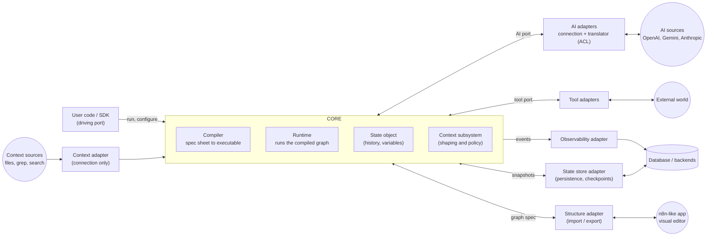
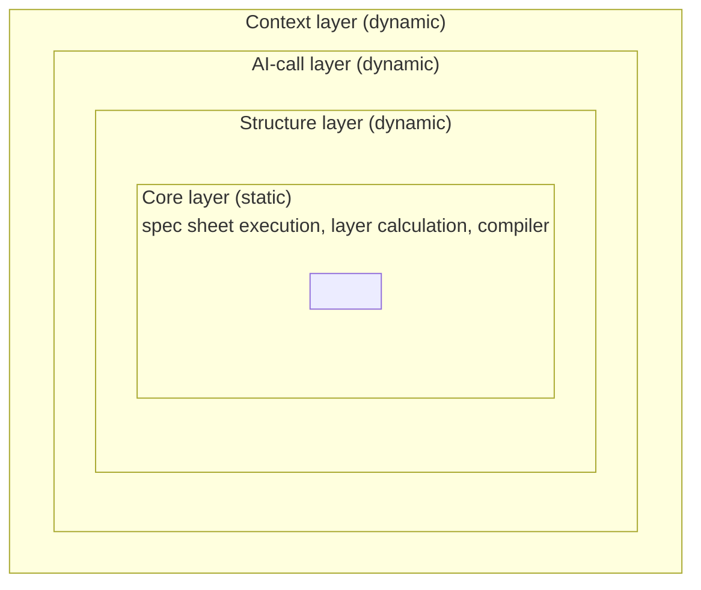
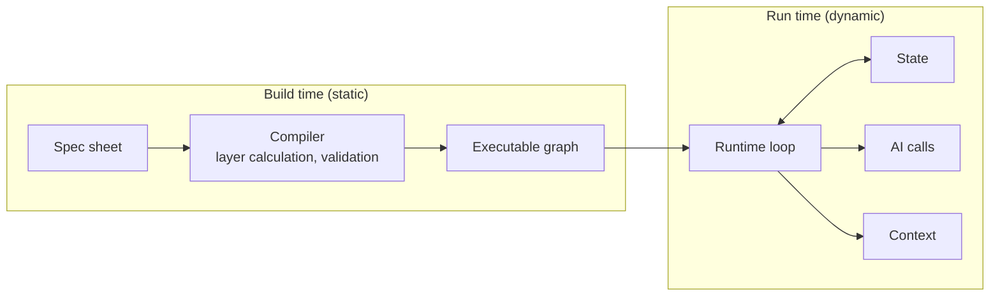
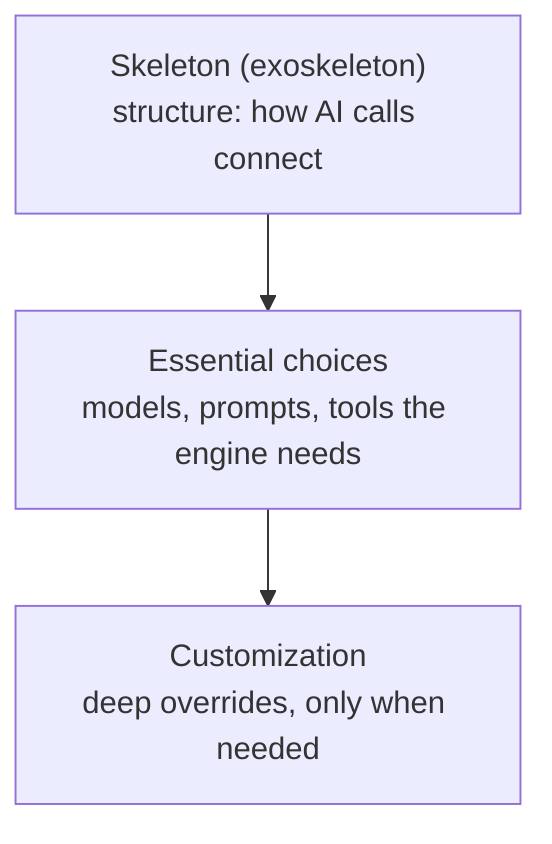

# Architecture

Original drawings: [v1 hexagon](whiteboards/v1-hexagon.png),
[v2 hexagon](whiteboards/v2-hexagon.png), [v2 layers](whiteboards/v2-layers.png).
Diagrams below are Mermaid redraws of them, with review changes applied and tagged.

## 1. Hexagonal view: core, ports, adapters



### Ports and adapters

| Port | Direction | Adapter does | Outside thing | Phase | Status |
|---|---|---|---|---|---|
| Public API (user code) | into core (driving) | n/a | user's program | 1 onward | **[suggested]** added after review; was missing |
| AI port | both ways | connection + translator; **multiple adapters** | AI providers | 1 | **[decided]** |
| Tool port | both ways | runs tools | external world | 2 | **[decided]** |
| Observability | out of core | emits events | database (AIOps use case) | 5 | **[decided]** |
| State store | both ways | save / load snapshots | database | 5 | **[decided]** |
| Context adapter | into core | connection only; internals belong to the context subsystem | context sources | later | **[decided]** |
| Structure adapter | both ways | import / export of the graph spec | n8n-like app / editor | 7 | **[decided]** |

Decisions recorded from discussion:

- **No "input / output" split** of the hexagon **[decided]**. Each port is labelled with its own
  direction (in, out, both).
- **Anti-corruption layer lives in the adapters** **[decided]**, one per external system, not as
  a wall around the core. Each adapter has a connection part and a translator part (the role
  `JSONStandardizer` plays today). The core only ever sees Needle's own types.
  Where translators physically live (one central class vs beside each adapter) is **[open]**.
- **Context:** the adapter only handles the connection **[decided]**. The context subsystem
  (what to do with fetched context: trim, summarize, drop old tool results) is inside the
  core and needs its own box **[suggested]**. Summarizing with an LLM goes through the AI port.
- **State** lives in the core; the state store only persists it **[decided]**. Implies state must
  be serializable **[suggested]**.
- The database circle is one picture, but observability and the state store are separate ports
  and may point at different backends **[suggested]**.

## 2. Spec sheet and compile step

The **spec sheet** is the declarative description of an agent. The **compiler** converts it
into executables (layer calculation, validation). **[decided]**

**[open]** Adarsh uses "spec sheet" for both the normalized response format and the graph
structure. The reviewer is asked whether these should be one schema or two (see
open-questions.md, Q4). Claude's suggestion: spec = program, messages = run-time data.

### Spec sheet sketch (Adarsh, informal)

Every execution requires an input (from the user or from an upstream agent's output), so the
spec declares an input; the value arrives at run time. **[leaning]** A node may itself contain
a whole structure (recursive definition), which gives agents-as-nodes and chaining.

```yaml
input:
  context:
    [context-stuff]
  input:
    input-type: [user, model, etc]
  AI-choice:
    ...
  structure:
    node1:
      [recursive definition of the overall structure]
    node2:
      ...
```

Observations **[suggested]**, not yet adopted:

- Nesting is a tree, but ReAct has a cycle and a conditional edge. Claude first suggested an
  `edges` list; Adarsh's alternative (below) expresses the cycle through input references, which
  works too. See "Loops and node types".
- `input-type` as drawn names the *source* (user, model). The spec should declare the *shape*
  (string, message list, structured object) so the compiler can check an upstream agent's
  output type against a downstream input type before anything runs. Source is run-time wiring.
- A default model at the top plus an optional per-node `model:` (override wins) covers ladder
  levels 0 and 1.
- The outer key `input` holds the whole spec; consider `inputs`, `context`, `models`,
  `structure`, `outputs`, plus a `spec_version`.
- Treat the spec as the serialization of typed objects validated against a schema, not a
  free-form dict. Code (`ReAct(llm, tools)`) and the file are then two front ends to one spec,
  and "eject" means showing that spec.

### Loops and node types (Adarsh)

A loop is formed through input references, with no separate edge list **[leaning]**:

- node1 takes the structure's input plus node3's output (seeded with an initial value, "redo",
  for the first pass),
- node2 takes node1's output and changes context after acting,
- node3 takes node2's output and forwards either to the end or back to node1.

The loop runs until node3 decides it is done. Limits (max loops, max tokens) live in node3,
the **End-Decider node**. A small set of built-in node types, implemented as classes that can
be extended: Action node, Reasoning node, End-Decider node, where End-Decider extends a base
Decider node. Whether an LLM or other tooling may be used to implement a decider "depending on
the situation" is raised but not settled.

Observations **[suggested]**:

- A back-reference is still an edge; the structure is a graph written as input bindings (a
  dataflow style). Tradeoff against an explicit edges list: bindings make data flow explicit;
  an edge list makes control flow and the visual editor easier. One can be derived from the other.
- A back-reference needs a defined seed for the first pass (Adarsh's "initially redo" covers it)
  and execution semantics (which node runs when, when the engine stops).
- **Compile-time safety check:** the compiler can refuse any cycle that does not pass through a
  decider with a bound, guaranteeing a loop always has a limit.
- Engine-level limits (global step cap, token budget across all nodes) should exist regardless
  of whether the user's decider includes them; the decider holds the user's stop *policy*.
- Prefer a small node interface (state in, update out) plus composition over deep inheritance:
  a decider as a role that returns a route, with the stop rule as a pluggable function and the
  limits as plain spec data. Spec files must name node types (a registry) so custom classes
  can be exported and imported.
- An End-Decider can default to a deterministic rule (for example, no tool call in the reply, or
  a limit hit) with an optional LLM-judged variant. This bears on open-questions Q18.

Further decisions and discussion on the above (Adarsh):

- Users can edit the nodes of any structure, like effect chains in Audacity (pick, reorder, edit
  inside). **[leaning]** Claude's note: removing a node can leave dangling references, so edits
  must rewire and the compiler must revalidate.
- Compiler checks **[leaning]**: a start node and an end node are required; every node must be
  reachable from the start; orphans produce warnings. **[suggested]** additions: a node that
  cannot reach the end is an error, and every cycle must pass through a bounded decider.
- Limits belong to the task and node, not one global number **[decided]**. Claude's split
  **[suggested]**: per-call output tokens are node configuration (set before the call, because a
  decider cannot cut a call short); cumulative budgets across iterations live in the decider,
  reading token usage from state; a high engine-level ceiling remains only as a seatbelt. This
  requires the canonical `Response` to carry token usage.
- Class hierarchies will be wide, not deep: a Decider base with 3-4 variants, a Reasoning node
  with 3-4 variants **[decided]**.
- End-Decider variants **[decided]**: `LLMEndDecider` (LLM-judged) and `DetEndDecider`
  (deterministic). Same role, different backend (a strategy).
- Adarsh mentioned **Jev** (TypeSafe AI, non-generative model for bounded decisions such as
  choice and yes/no, returning probabilities; sources are secondary and the speed claims are
  unverified). **[suggested]** design implication: deciders ask a *bounded question*, which is a
  different capability from text generation. Consider a "choose among these options, return the
  choice and a confidence" operation on the AI side, implementable with ordinary LLMs via
  constrained output or with a specialist model, so Needle does not depend on one vendor.
  Not Phase 1.

Phase: 3 (graph runtime and compiler). Recorded now, not designed now.

### Static core and dynamic layers (as drawn, [v2 layers](whiteboards/v2-layers.png))



- Core layer is **static**. Context, AI-call and structure are **dynamic**: "things that can
  change depending on connector I/O and user interactions". **[decided]**
- Outer layers connect to: AI sources adapter, state management, observability, tools (AI-call
  layer); the context adapter; the structure adapter.
- Execution framing: nesting here means **execution dependency** (what runs in what).

Claude's restatement of the same idea as build time vs run time **[suggested]**:



Prior-art names for this split (from memory, not verified): define-and-run vs define-by-run;
staged computation; LangGraph's `.compile()`.

## 3. Customization ladder

Nesting here means **calling dependency**: the order in which a user makes decisions, and how
deep they have to go. **[decided]** The skeleton is chosen first; later layers refer to things
the skeleton defines, so the skeleton must be settled before going deeper. Any structure should
combine with any level of customization.



Arrows read "decided after / refers to". Whiteboard version drew these as concentric hexagons
with the skeleton outermost.

Concrete example **[suggested]**:

| Level | ReAct example |
|---|---|
| 0 | `ReAct(llm, tools)`, all defaults |
| 1 | choose model or prompt per node |
| 2 | swap or edit nodes in the graph (the "eject" API) |
| 3 | custom nodes, edges, state |

**[open]** "Any shape with any customization" needs a mapping of which skeleton objects accept
which customizations. Claude's suggestion: each skeleton declares named, typed **slots**
(`reason`, `act`, `observe`), and customizations bind to slot types, which avoids an
N x M matrix.

**[open]** Do the ladder (calling dependency) and the layers (execution dependency) describe
the same three or four things from two angles, or two independent systems? Not reconciled.

## 4. Requirements that cut across the diagrams

- **Canonical history, translated at the edge.** Conversation is stored only in Needle's format;
  each adapter translates canonical to provider on the way out and back on the way in. This is
  what makes a model switch free **[leaning]**. Today's `JSONStandardizer` only does the way back.
- **LLM objects are stateless**; history lives in state. Models are chosen per node **[leaning]**.
- **Context engineering** as functions over canonical messages (truncate, summarize, drop bulky
  tool results), provider-independent **[leaning]**.
- **Serializable data** throughout, so checkpointing and the graph JSON come cheaply **[leaning]**.
- Known cross-provider hazards to design for **[suggested]**: tool-call ids, provider-private
  reasoning blocks with signatures, system-prompt placement, role-ordering rules, tokenizer and
  context-window differences, lost prompt caches on a switch.
- **Not yet drawn:** failure handling, step limits and token budgets; how users test their own
  agents; a declarative form for levels 2 and 3. **[open]**

## 5. Phase scoping

Only the **AI port, canonical types, translators and the public API** are Phase 1. The tool port
is Phase 2, the compiler and runtime Phase 3, prebuilt patterns Phase 4, observability and the
state store Phase 5, structure import/export and editor Phase 7. Streaming is deferred; the
response type should leave room for it **[leaning]**.
