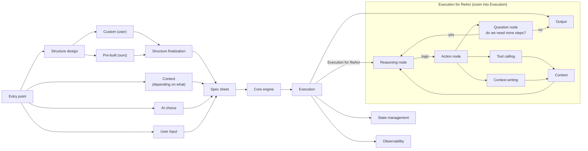

# ReAct execution flow

Original drawings: [react-flow.png](whiteboards/react-flow.png) (first version) and
[react-flow-v2.png](whiteboards/react-flow-v2.png) (adds "User input" feeding the spec sheet).
The diagram below is a Mermaid transcription of v2. Pre-check observations are listed after
it and tagged **[suggested]**; Adarsh has not adopted them yet.

## The flow as drawn

Left of "Spec sheet" is assembly (build time); right of it is execution (run time). The lower
group is a zoom into the "Execution" box for ReAct.

## How it maps to the architecture

- **Entry point** is the driving port (the user's call).
- Spec sheet inputs are the structure (skeleton, either pre-built or custom), the context
  configuration, the AI (model) choice, and (v2) the user's input. This matches the customization ladder: skeleton,
  then essential choices, then custom.
- **Structure finalization** is where the compile-time validation would sit.
- The ReAct nodes (reasoning, action, question, tool calling, context writing) are the
  candidates for named **slots** in the skeleton.

## Boxes each step touches (the answer to "which arrows touch ReAct?")

**[suggested]** by Claude as a starting point for Adarsh to confirm or correct. The trace
table below is Adarsh's to write.

| Node | Port it would touch |
|---|---|
| Reasoning node | AI port |
| Question node (if it is an LLM call) | AI port |
| Tool calling | tool port |
| Context / context writing | context subsystem; state (see Q17 in open-questions.md) |
| Execution (each step) | observability, state store |

## Trace (to be written by Adarsh)

For one concrete request, step by step: what happens, which boxes it touches, what data
crosses (named as Needle's own types), and what could fail. Then two variations: switch the
model mid-loop, and interrupt and resume from saved state.

_Not written yet._

## Pre-check observations [suggested]

1. **User input inside the spec sheet (v2).** v2 fixes the missing entry for the question, but
   makes the spec per-request. Tradeoff: with input in the spec, the agent is recompiled on
   every call and the spec is no longer a reusable, exportable agent definition. With input
   outside the spec (compile once, run per request) the question would become the first
   message in the initial state, which also fits resuming from a checkpoint (the question is
   already in saved history). **[open]**, Adarsh to decide. A test: would the export to the
   visual editor contain the user's question?
2. **The "eject" path is missing.** Pre-built goes straight to Structure finalization. The pitch
   is pre-built *then modified*; there is no edge for customizing a pre-built structure.
3. **AI choice is one box.** The requirement is a model per node. In the loop, the reasoning,
   question and action nodes could each use a different model, so AI choice has to bind to
   slots, not to the agent as a whole.
4. **State vs context.** The loop reads and writes "Context", while "State management" hangs off
   Execution as a sink. Where does the message history live: in state (the core object the
   graph operates on) or in context (a subsystem)? State is also needed by every step, not only
   saved at the end.
5. **Question node.** Is "do we need more steps?" a second LLM call each loop, or a deterministic
   check (for example, the model's reply contained no tool call)? An extra call per iteration
   costs tokens; either way a step limit is a likely guard.
6. **Observation step.** In ReAct the tool result is the observation. Here it flows through
   Context. Ordering matters for providers: the assistant's tool-call message must be recorded
   before its tool result. Does "context writing" cover both appends, and who guarantees order?
7. **Parallel tool calls.** One "Tool calling" box; can the model request several tools in one
   turn, and are they run concurrently?
8. **No failure paths.** Tool error, model error or timeout, max steps reached, bad tool
   arguments: none have edges.
9. **Two arrows into Output.** Execution to Output and the Question node's "no" both reach it.
   If the lower group is the inside of Execution, one arrow suffices.
10. **Observability granularity.** It hangs off Execution as one box; events (model call, tool
    call, token usage) would come from each node.
